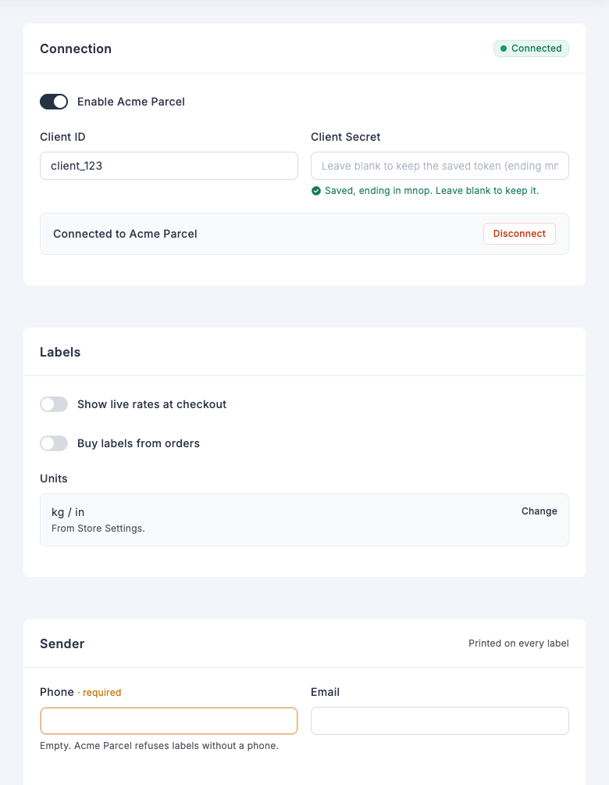

# Carrier Settings

FluentCart draws your carrier's settings page from `fields()`, including the **Save settings** and **Discard** buttons, so you write no Vue. The page is at **Settings → Shipping → Carriers → your carrier**.



This page comes from these fields:

| On the page | Field |
| ----------- | ----- |
| Connection, Labels and Sender cards | `section` |
| "Connected" tag | `badge` on the section |
| "Printed on every label" | `aside` on the section |
| Enable, rates and labels switches | `toggle` |
| Client ID and Phone, Client Secret and Email in two columns | `'width' => 'half'` |
| Saved secret note | `password` |
| Connected strip with its Disconnect button | `status` with an action |
| Units row with its Change link | `readonly` with a `link` |
| "required" beside Phone | `label_note` |
| Warning under the empty Phone field | `empty_hint` |

## Carrier details

`meta()` describes the carrier.

| Key | Required | Purpose |
| --- | -------- | ------- |
| `slug` | Yes | Must match the key you registered it under. |
| `name` | Yes | Shown in the carrier list, the shipment form and on shipments. |
| `description` | No | Shown in the carrier list. |
| `supports` | No | Any of `rates`, `labels`, `tracking`. |
| `webhook_hint` | No | Instructions shown under the webhook URL. |

A carrier without `slug` and `name` is left out of the settings pages.

## Saving

A save runs in this order:

1. Keeps only the keys you declared. An undeclared key in the request is dropped.
2. Drops an empty secret, which means the admin did not retype it, so the stored value stays.
3. Sanitizes the values and converts toggles to `yes` or `no`.
4. Calls `validateSettings()`. Return the array, changed if you need to, or a `WP_Error` to reject the save with your message.
5. Merges the result into the stored settings.

### Storing your own data

Your carrier can store values the merchant never edits, such as tokens, a webhook secret or the time of the last event. Add them in `validateSettings()`, or call `$this->settings->save()` at any time:

```php
$this->settings->save(['last_event_at' => gmdate('Y-m-d H:i:s')]);
```

`save()` merges into the stored settings, so other keys stay as they are. Keys you did not declare in `fields()` are never sent to the browser. Add them to `getDefaults()` as well.

Read a value with `$this->settings->get('key')`. Give every key a value in `getDefaults()`.

`isEnabled()` decides whether checkout offers your carrier. The default checks that `is_active` is `yes`. Override it to require credentials as well. `ProvidesLiveRates` also requires an `enable_rates` setting of `yes`.

## Input fields

Every field has a `key`, `type` and `label`. Keys share one store, so each must be unique. `hint` adds help text.

| Type | Stores | Notes |
| ---- | ------ | ----- |
| `text` | String | `placeholder` is optional. |
| `password` | String | Returned to the browser as an empty string. The form shows that a value is saved and its last four characters. |
| `toggle` | `yes` or `no` | |
| `select` | Option value | `'options' => [['value' => 'a', 'label' => 'A'], ...]`. Add `groups` for a searchable list with headings: `'groups' => [['label' => 'Your accounts', 'options' => [...]]]`. |
| `mode` | Option value | Radio cards. Each option can hold its own `fields`. |

Input fields also accept:

- `label_note`: a small note beside the label.
- `'width' => 'half'`: two fields share a row.
- `empty_hint`: a message shown while the field is empty, such as `['tone' => 'warn', 'text' => 'Labels need a phone.']`.

Add `'is_secret' => true` to mask any other field type in the same way as a password.

A `mode` field shows an option's fields only while it is selected. Nesting is limited to one level.

```php
[
    'key'     => 'sandbox_mode',
    'type'    => 'mode',
    'label'   => __('Connection Mode', 'acme-parcel-for-fluent-cart'),
    'options' => [
        [
            'value'  => 'no',
            'label'  => __('Live', 'acme-parcel-for-fluent-cart'),
            'hint'   => __('Labels are real and billed.', 'acme-parcel-for-fluent-cart'),
            'fields' => [
                ['key' => 'live_key', 'type' => 'password', 'label' => __('Live Key', 'acme-parcel-for-fluent-cart')],
            ],
        ],
        [
            'value'  => 'yes',
            'label'  => __('Test', 'acme-parcel-for-fluent-cart'),
            'fields' => [
                ['key' => 'test_key', 'type' => 'password', 'label' => __('Test Key', 'acme-parcel-for-fluent-cart')],
            ],
        ],
    ],
],
```

## Display fields

These show information and store nothing. Each one still needs a unique `key`.

| Type | Keys | Purpose |
| ---- | ---- | ------- |
| `section` | `label`, `hint`, `aside`, `badge`, `active_if` | Starts a new card. `aside` is short text in the card header. `badge` is a tag such as `['text' => 'Connected', 'tone' => 'ok', 'dot' => true]`, with a `tone` of `ok`, `warn`, `err` or `mute`. `active_if` dims the card until a field has a value: `['key' => 'is_active', 'value' => 'yes']`. |
| `webhook_url` | | Places the webhook URL here. Without it, the URL appears at the end of the form. |
| `status` | `title`, `text`, `tone`, `items`, `actions`, `note` | A strip with facts and buttons. `tone` of `err` shows it as an error. |
| `readonly` | `label`, `value`, `hint`, `link` | A value managed elsewhere. |
| `notice` | `text`, `tone`, `link` | An inline message. `tone` is `mute`, `warn` or `err`. |
| `webhook_setup` | `label`, `steps`, `open`, `mask_param` | Manual setup steps with a masked URL. `mask_param` names the query argument to hide. `**word**` in a step is shown in bold. |

A `link` is `['label' => 'Change', 'route' => '/settings/store-settings']`, using a route in the FluentCart admin.

Any field can use `show_if` to appear only while another field has a value. A hidden field keeps its stored value.

```php
['key' => 'label_format', 'type' => 'text', 'label' => 'Label format', 'show_if' => ['key' => 'enable_labels', 'value' => 'yes']],
```

## Status actions

A button in a `status` field runs at once, without Save. Use it for actions such as testing a connection.

```php
[
    'key'     => 'connection',
    'type'    => 'status',
    'title'   => __('Connection', 'acme-parcel-for-fluent-cart'),
    'text'    => __('Check that your API key works.', 'acme-parcel-for-fluent-cart'),
    'actions' => [
        ['action' => 'test_connection', 'label' => __('Test connection', 'acme-parcel-for-fluent-cart'), 'variant' => 'primary'],
    ],
],
```

An action can also set `variant` to `danger`, and `confirm` to `['title' => '', 'text' => '', 'button' => '']` to ask first.

The button calls `runAction()`:

```php
public function runAction(string $action, array $data)
{
    if ($action !== 'test_connection') {
        return parent::runAction($action, $data);
    }

    $response = $this->request('GET', '/account');

    return is_wp_error($response)
        ? ['ok' => false, 'message' => $response->get_error_message()]
        : ['ok' => true, 'message' => __('Connected.', 'acme-parcel-for-fluent-cart')];
}
```

Return `message` and `ok`, or a `WP_Error`. The page then reloads the carrier, so `fields()` can reflect what the action stored. The route needs the `store/sensitive` permission.

## Connecting with OAuth

A carrier that uses an API key needs only a `password` field. A carrier that uses OAuth needs the merchant to log in on the carrier's site and return.

Buttons on the settings page run in the background, and a `link` opens FluentCart admin routes. So start the login from a full-page link and handle both ends with a FluentCart route, the same way the Stripe and PayPal connections work. `?fluent-cart={name}` on your site fires `fluent_cart_action_{name}`.

### 1. Add the route and the link

```php
add_action('fluent_cart_action_acme_connect', function ($data) {
    \FluentCart\App\Modules\Shipping\Carriers\Core\CarrierManager::carrier('acme')->handleConnect($data);
});

add_filter('plugin_action_links_' . plugin_basename(__FILE__), function ($links) {
    if (current_user_can('manage_options') && class_exists('\\AcmeParcel\\AcmeCarrier')) {
        $links[] = '<a href="' . esc_url(\AcmeParcel\AcmeCarrier::connectUrl()) . '">' . esc_html__('Connect', 'acme-parcel-for-fluent-cart') . '</a>';
    }

    return $links;
});
```

This puts **Connect** on the WordPress Plugins screen. Tell the merchant where to find it with a `status` field on your settings page.

### 2. Send the merchant out and handle the return

```php
const AUTHORIZE_URL = 'https://auth.acme-parcel.example/oauth/login';
const TOKEN_URL     = 'https://auth.acme-parcel.example/oauth/token';

public static function connectUrl(): string
{
    return add_query_arg([
        'fluent-cart' => 'acme_connect',
        'intent'      => 'connect',
        '_wpnonce'    => wp_create_nonce('acme_connect'),
    ], home_url('/'));
}

public function handleConnect(array $data): void
{
    if (!current_user_can('manage_options')) {
        wp_die(esc_html__('You do not have permission to do this.', 'acme-parcel-for-fluent-cart'), '', ['response' => 403]);
    }

    $intent     = sanitize_key((string) Arr::get($data, 'intent', ''));
    $stateKey   = 'acme_oauth_state_' . get_current_user_id();
    $redirectTo = add_query_arg(['fluent-cart' => 'acme_connect', 'intent' => 'callback'], home_url('/'));

    if ($intent === 'connect') {
        check_admin_referer('acme_connect');

        $state = wp_generate_password(32, false);
        set_transient($stateKey, $state, 10 * MINUTE_IN_SECONDS);

        wp_redirect(add_query_arg([
            'response_type' => 'code',
            'client_id'     => rawurlencode((string) $this->settings->get('client_id')),
            'redirect_uri'  => rawurlencode($redirectTo),
            'state'         => $state,
        ], self::AUTHORIZE_URL));
        exit;
    }

    $state    = (string) Arr::get($data, 'state', '');
    $expected = (string) get_transient($stateKey);
    delete_transient($stateKey);

    if ($intent !== 'callback' || $expected === '' || !hash_equals($expected, $state)) {
        wp_die(esc_html__('This connection request has expired. Please try again.', 'acme-parcel-for-fluent-cart'), '', ['response' => 400]);
    }

    $tokens = $this->requestTokens([
        'grant_type'   => 'authorization_code',
        'code'         => sanitize_text_field((string) Arr::get($data, 'code', '')),
        'redirect_uri' => $redirectTo,
    ]);

    if (is_wp_error($tokens)) {
        wp_die(esc_html($tokens->get_error_message()), '', ['response' => 502]);
    }

    $this->storeTokens($tokens);

    wp_safe_redirect(admin_url('admin.php?page=fluent-cart#/settings/shipping/carriers/' . self::SLUG));
    exit;
}
```

Register `https://your-site.com/?fluent-cart=acme_connect&intent=callback` as the redirect URL in your OAuth app. This route is public, so keep all three checks: the `manage_options` permission, the nonce when the login starts, and the single-use `state` when it returns.

### 3. Store and refresh the tokens

```php
/**
 * @return string|\WP_Error
 */
protected function accessToken()
{
    if ((int) $this->settings->get('token_expires_at') > time() + MINUTE_IN_SECONDS) {
        return Helper::decryptKey((string) $this->settings->get('access_token'));
    }

    $tokens = $this->requestTokens([
        'grant_type'    => 'refresh_token',
        'refresh_token' => Helper::decryptKey((string) $this->settings->get('refresh_token')),
    ]);

    if (is_wp_error($tokens)) {
        return $tokens;
    }

    $this->storeTokens($tokens);

    return (string) $tokens['access_token'];
}

protected function storeTokens(array $tokens): void
{
    $refreshToken = (string) Arr::get($tokens, 'refresh_token', '');

    $this->settings->save([
        'access_token'     => Helper::encryptKey((string) $tokens['access_token']),
        'refresh_token'    => $refreshToken !== '' ? Helper::encryptKey($refreshToken) : $this->settings->get('refresh_token'),
        'token_expires_at' => time() + (int) Arr::get($tokens, 'expires_in', 0),
    ]);
}

/**
 * @return array|\WP_Error
 */
protected function requestTokens(array $body)
{
    $response = wp_remote_post(self::TOKEN_URL, [
        'timeout' => 15,
        'headers' => ['Authorization' => 'Basic ' . base64_encode($this->settings->get('client_id') . ':' . $this->settings->get('client_secret'))],
        'body'    => $body,
    ]);

    if (is_wp_error($response)) {
        return new \WP_Error('acme_unreachable', $response->get_error_message(), ['http_code' => 0]);
    }

    $code = (int) wp_remote_retrieve_response_code($response);
    $data = json_decode(wp_remote_retrieve_body($response), true);

    if ($code !== 200 || empty($data['access_token'])) {
        return new \WP_Error('acme_token_failed', __('Acme Parcel refused the connection.', 'acme-parcel-for-fluent-cart'), ['http_code' => 401]);
    }

    return $data;
}
```

Call `accessToken()` in your API request and send the result as the bearer token. Return its `WP_Error` if it fails. `Helper::encryptKey()` keeps the tokens encrypted in the database. A failed refresh shows no rates at checkout and backs off for 60 seconds, and the stored tokens stay. Show this to the merchant with a setup notice.

If your provider issues a new refresh token each time, two checkouts can refresh at once and one can lose. Guard the refresh with a short lock in that case.

### 4. Disconnect

A `status` button works here, because nothing leaves the page:

```php
public function runAction(string $action, array $data)
{
    if ($action !== 'disconnect') {
        return parent::runAction($action, $data);
    }

    $this->settings->save(['access_token' => '', 'refresh_token' => '', 'token_expires_at' => 0]);

    return ['ok' => true, 'message' => __('Disconnected.', 'acme-parcel-for-fluent-cart')];
}
```

Make `isEnabled()` require the refresh token, so checkout offers the carrier only while it is connected:

```php
public function isEnabled(): bool
{
    return $this->settings->get('is_active') === 'yes' && (string) $this->settings->get('refresh_token') !== '';
}
```

## Setup notices

`getSetupNotices()` lists problems the merchant must fix. They appear on the carrier pages, and the carrier list marks the carrier as needing attention.

```php
public function getSetupNotices(): array
{
    $notices = [];

    if ($this->settings->get('is_active') === 'yes' && !$this->settings->get('api_key')) {
        $notices[] = [
            'type'    => 'error',
            'message' => __('Add your API key to start showing rates.', 'acme-parcel-for-fluent-cart'),
            'action'  => null,
        ];
    }

    return $notices;
}
```

`type` is `error`, `warning` or `info`. `action` is `null` or `['label' => '', 'route' => '']`. This method runs each time the carrier list loads, so read stored settings only and do not call your API.

The `ProvidesSetupNotices` trait adds two helpers. `originSetupNotice($carrierName)` returns a notice when the store address is incomplete, or `null`. `setupNotice($type, $message)` builds a plain notice. It needs `buildOrigin()`, which `ProvidesLiveRates` provides.
