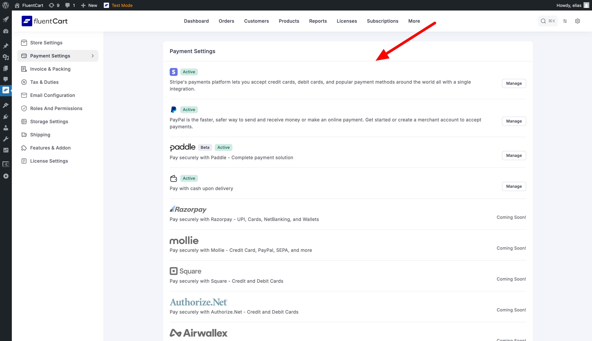
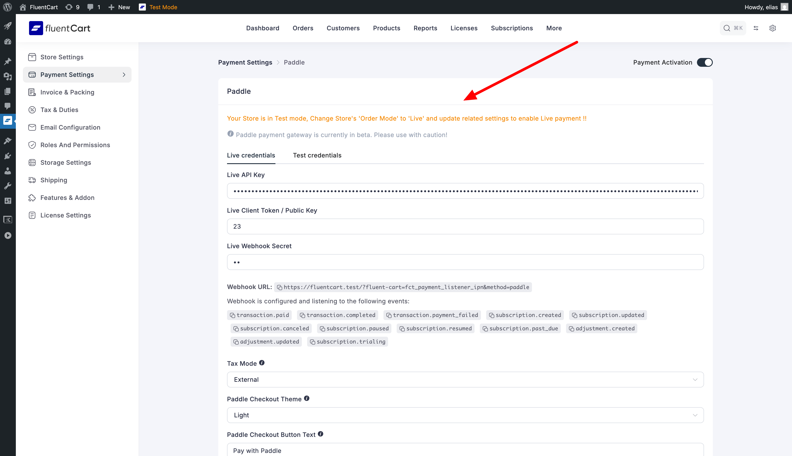
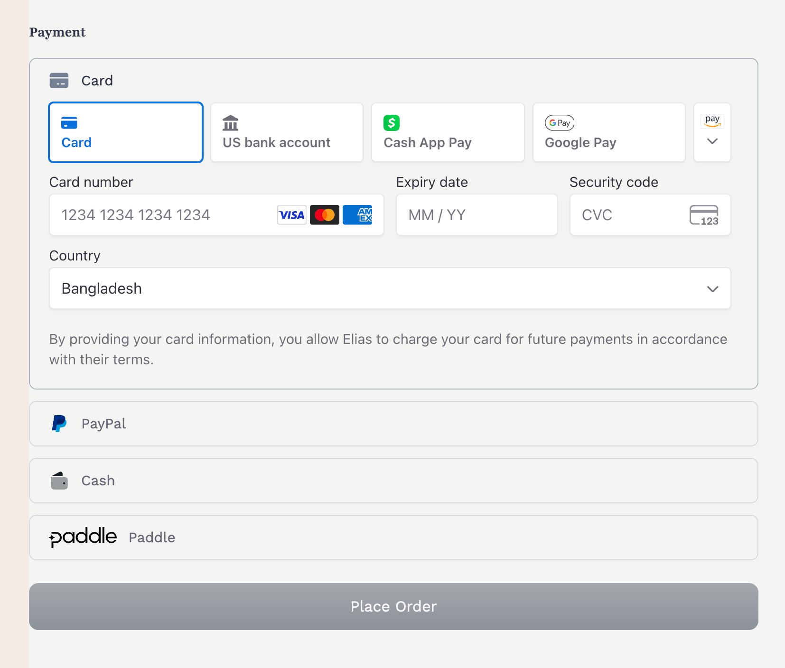

# Payment Gateway Integration Guide

This guide provides a step-by-step approach to integrate your payment gateway with FluentCart. Follow these steps to create a fully functional payment gateway with support for one-time payments, subscriptions, and web hooks.

## Implementation Steps

### Step 1: Register Your Gateway

In your plugin's main file, register your gateway with FluentCart using the hook approach (recommended):

```php
// In your-plugin.php
add_action('fluent_cart/register_payment_methods', function() {
    if (!function_exists('fluent_cart_api')) {
        return; // FluentCart not active
    }
    
    // Register your custom gateway
    fluent_cart_api()->registerCustomPaymentMethod(
        'your_gateway', 
        new \YourPlugin\PaymentMethods\YourGateway\YourGateway()
    );
});
```

::: warning Don't eagerly `require` your gateway class file
`fluent_cart/register_payment_methods` fires on WordPress `init` (after FluentCart's own `plugins_loaded` → `fluentcart_loaded` → `init` chain), so calling `registerCustomPaymentMethod` inside it — as shown above — is already safe timing-wise. The pitfall is elsewhere: if your plugin's bootstrap `require`s the file that *defines* `class YourGateway extends AbstractPaymentGateway` too early (top-level in your main plugin file, or tied to `fluentcart_loaded`), PHP fatals on class-not-found at include time — `AbstractPaymentGateway`/`BaseGatewaySettings` may not exist yet at that point. Only `require`/autoload the gateway class file from inside the `fluent_cart/register_payment_methods` callback itself (or via lazy PSR-4 autoloading triggered by `new YourGateway()` there), same as the example above.
:::

Alternatively, you can register on the `init` hook (not recommended):

```php
add_action('init', function() {
    if (!function_exists('fluent_cart_api')) {
        return;
    }
    fluent_cart_api()->registerCustomPaymentMethod('your_gateway', new \YourPlugin\PaymentMethods\YourGateway\YourGateway());
});
```

### Step 2: Create the Settings Class

Create a settings class that extends `BaseGatewaySettings`:

```php
<?php
namespace YourPlugin\PaymentMethods\YourGateway;

use FluentCart\App\Helpers\Helper;
use FluentCart\App\Modules\PaymentMethods\Core\BaseGatewaySettings;
use FluentCart\Framework\Support\Arr;

class YourGatewaySettings extends BaseGatewaySettings
{
    public $methodHandler = 'fluent_cart_payment_settings_your_gateway';

    public static function getDefaults()
    {
        return [
            'is_active'           => 'no',
            'payment_mode'        => 'test', // test or live
            'test_api_key'        => '',
            'test_secret_key'     => '',
            'test_webhook_secret' => '',
            'live_api_key'        => '',
            'live_secret_key'     => '',
            'live_webhook_secret' => '',
        ];
    }

    // Required by BaseGatewaySettings.
    public function get($key = '')
    {
        if ($key) {
            return Arr::get($this->settings, $key);
        }

        return $this->settings;
    }

    // Required by BaseGatewaySettings.
    public function getMode()
    {
        return $this->get('payment_mode');
    }

    // Required by BaseGatewaySettings.
    public function isActive()
    {
        return $this->get('is_active') === 'yes';
    }

    public function isTestMode()
    {
        return $this->getMode() === 'test';
    }

    public function getApiKey($mode = '')
    {
        $mode = $mode ?: $this->getMode();

        return $this->get($mode . '_api_key');
    }

    public function getSecretKey($mode = '')
    {
        $mode = $mode ?: $this->getMode();

        return (string) Helper::decryptKey($this->get($mode . '_secret_key'));
    }

    public function getWebhookSecret($mode = '')
    {
        $mode = $mode ?: $this->getMode();

        return (string) Helper::decryptKey($this->get($mode . '_webhook_secret'));
    }
}
```

Encrypt the secret fields when the settings are saved. Add this to your gateway class
(Step 3):

```php
public static function beforeSettingsUpdate($data, $oldSettings): array
{
    $secretFields = ['test_secret_key', 'live_secret_key', 'test_webhook_secret', 'live_webhook_secret'];

    foreach ($secretFields as $field) {
        $value = Arr::get($data, $field, '');

        // Encrypt only a value that changed. The stored one is already encrypted.
        if ($value && $value !== Arr::get($oldSettings, $field, '')) {
            $data[$field] = Helper::encryptKey($value);
        }
    }

    return $data;
}
```

Call `Helper::decryptKey()` only on a field you encrypted here. It returns `false` for a plain
value that is valid base64, and most API keys are.

### Step 3: Create your Gateway Class

Create base class that implements all required methods:

```php
<?php
namespace YourPlugin\PaymentMethods\YourGateway;

use FluentCart\App\Helpers\Helper;
use FluentCart\App\Modules\PaymentMethods\Core\AbstractPaymentGateway;
use FluentCart\App\Services\Payments\PaymentInstance;
use FluentCart\Framework\Support\Arr;

class YourGateway extends AbstractPaymentGateway
{
    // Define supported features
    // 'payment' and 'refund' are queried through has(). 'webhook' is
    // declarative, and every built-in gateway lists it.
    //
    // Leave 'subscriptions' out: AbstractPaymentGateway::__construct() appends
    // it when you pass a subscription module.
    public array $supportedFeatures = [
        'payment',
        'refund',
        'webhook'
    ];
    

    public function __construct()
    {
        // AbstractPaymentGateway::__construct() is type-enforced: it requires a
        // BaseGatewaySettings instance as its first argument. Passing anything else
        // (or omitting it) is a fatal TypeError, not a soft failure.
        parent::__construct(new YourGatewaySettings());

    }

    public function boot()
    {
        // initialize any hanldere, webhook/ payment confirmation class if needed
    }

    // Required: Return gateway metadata
    public function meta(): array
    {
        return [
            'title' => __('Your Gateway', 'your-plugin'),
            'route' => 'your_gateway',
            'slug' => 'your_gateway',
            'description' => __('Accept payments with Your Gateway', 'your-plugin'),
            'logo' => plugin_dir_url(__FILE__) .
                'assets/images/logo.svg',
            'icon' => plugin_dir_url(__FILE__) . 
                'assets/images/icon.svg',
            'status' => $this->settings->get('is_active') === 'yes',
            'supported_features' => $this->supportedFeatures
        ];
    }

    // Not required: AbstractPaymentGateway already implements has() against
    // $supportedFeatures. Override it only if you need custom feature logic.

    // Required: Process payment
    public function makePaymentFromPaymentInstance(PaymentInstance $paymentInstance)
    {
        // Your payment processing logic here
        
    }

    // Required: Handle IPNs/Webhooks
    public function handleIPN()
    {
        // Process the webhook
        
    }
    

    #required: Return settings fields configuration
    public function fields(): array
    {
        // For a comprehensive guide on building gateway settings fields,
        // see the detailed [Payment Gateway Settings Fields] documentation link given below
        return [
            ....
        ];
    }
    
    // For a comprehensive guide on building gateway settings fields,
    // see the detailed documentation: [Payment Gateway Settings Fields](./payment_setting_fields.md)

    // Required: declared on PaymentGatewayInterface, not just a convention —
    // omitting it is a fatal "abstract method not implemented" error, even though
    // AbstractPaymentGateway doesn't spell it out with a PHP `abstract` keyword.
    #required: Get order information for frontend
    public function getOrderInfo(array $data)
    {
        // Prepare frontend data for checkout
        $paymentArgs = [];
        
        // Return data for frontend
        wp_send_json([
            'status' => 'success',
            'payment_args' => $paymentArgs,
            'message' => __('Order info retrieved', 'your-plugin')
        ], 200);
    }

    #required: Register scripts (automatically called by base gateway)
    public function getEnqueueScriptSrc($hasSubscription = 'no'): array
    {
        // External gateway library, custom checkout scripts (if needed), otherwise return empty array
        $gatewayLibUrl = 'https://js.yourgateway.com/v1/checkout.js';
        
        return [
            [
                'handle' => 'your-gateway-external-lib',
                'src' => $gatewayLibUrl,
            ],
            [
                'handle' => 'fluent-cart-your-gateway-checkout',
                'src' => plugin_dir_url(__FILE__) . 'assets/js/your-gateway-checkout.js',
                'deps' => ['your-gateway-external-lib'],
                'version' => FLUENTCART_VERSION
            ]
        ];
    }
}
```

#### fields() method setup
 For a comprehensive guide on building gateway settings fields, see the detailed documentation: [Payment Gateway Settings Fields](./payment_setting_fields.md)

Now your gateway registration is done, you will see your gateway in the payment methods list in FluentCart admin dashboard. And if you follow the [Fields](./payment_setting_fields.md) guide and Configure your gateway settings and save with <b>Payment activation</b> on, you will see the gateway in the payment methods list in FluentCart checkout page.

### Step 4: Create JavaScript File for Frontend Checkout

FluentCart uses a custom event system to load payment methods in the checkout page. When a customer selects your payment method, FluentCart triggers a custom event in the format: `fluent_cart_load_payments_[payment_method_slug]`.

::: warning Required — the Place Order button stays disabled without this
Every gateway **must** register a listener for its `fluent_cart_load_payments_[payment_method_slug]` event and call `e.detail.paymentLoader.enableCheckoutButton()` once the gateway is ready to accept the order. FluentCart keeps the Place Order button greyed out while the selected payment method is loading, and it is your listener's `enableCheckoutButton()` call that re-enables it. If the listener is missing (or never calls `enableCheckoutButton()`), the Place Order button stays greyed out and the customer cannot check out — even a gateway with no frontend UI (offline/COD-style) needs this listener.
:::

Your JavaScript file must listen for this event and handle the payment process accordingly. Here's a simple example:

```javascript
window.addEventListener("fluent_cart_load_payments_your_gateway", function (e) {
    const submitButton = window.fluentcart_checkout_vars?.submit_button;
    const gatewayContainer = document.querySelector('.fluent-cart-checkout_embed_payment_container_your_gateway');
    const translations = window.fct_your_gateway_data?.translations || {};

    function $t(string) {
        return translations[string] || string;
    }

    // Simple implementation (like COD/offline payments)
    if (gatewayContainer) {
        gatewayContainer.innerHTML = `<p>${$t('Your payment instructions here.')}</p>`;
    }

    // Enable the checkout button
    e.detail.paymentLoader.enableCheckoutButton(submitButton.text);
    
    // OR if you need to integrate with a third-party SDK:
    // loadYourGatewaySDK(e.detail.paymentInfoUrl, e.detail.nonce, e.detail.form, e.detail.paymentLoader);
});

// Example function for loading a more complex gateway SDK
function loadYourGatewaySDK(paymentInfoUrl, nonce, form, paymentLoader) {
    // Fetch payment information from server
    fetch(paymentInfoUrl, {
        method: "POST",
        headers: {
            "Content-Type": "application/json",
            "X-WP-Nonce": nonce,
        },
        credentials: 'include'
    }).then(response => response.json())
    .then(data => {
        // Initialize your gateway SDK with the data
        // When ready, enable the checkout button:
        paymentLoader.enableCheckoutButton('Pay Now');
    });
}
```

#### Payment methods list in FluentCart admin dashboard


#### Payment method settings configuration page


#### Active payment methods displayed in checkout page



## Start taking payments with your gateway

## Step 4: Create an API Handler

Create a class for API communications with your payment provider:

```php
<?php
namespace YourPlugin\PaymentMethods\YourGateway;

use FluentCart\Framework\Support\Arr;

class API
{
    private $settings;
    private $mode;
    private $baseUrl;

    // $mode: pass the payment's own mode when you read or change an existing payment.
    public function __construct(YourGatewaySettings $settings, $mode = '')
    {
        $this->settings = $settings;
        $this->mode = $mode ?: $settings->getMode();
        $this->baseUrl = $this->mode === 'test'
            ? 'https://api-test.yourgateway.com/v1'
            : 'https://api.yourgateway.com/v1';
    }

    public function makeRequest($method, $endpoint, $data = [])
    {
        $args = [
            'method' => $method,
            'headers' => [
                'Authorization' => 'Bearer ' . $this->settings->getApiKey($this->mode),
                'Content-Type' => 'application/json',
            ],
            'timeout' => 30
        ];

        if (!empty($data) && in_array($method, ['POST', 'PUT'])) {
            $args['body'] = json_encode($data);
        }

        $response = wp_remote_request($this->baseUrl . $endpoint, $args);

        if (is_wp_error($response)) {
            return [
                'success' => false,
                'message' => $response->get_error_message()
            ];
        }

        $body = wp_remote_retrieve_body($response);
        $data = json_decode($body, true);
        $code = wp_remote_retrieve_response_code($response);

        if ($code >= 400 || !is_array($data)) {
            return [
                'success' => false,
                'message' => is_array($data) ? Arr::get($data, 'error', 'API request failed') : 'Unreadable API response'
            ];
        }

        return [
            'success' => true,
            'data' => $data
        ];
    }

    public function createPayment($paymentData)
    {
        return $this->makeRequest('POST', '/payments', $paymentData);
    }

    public function getPayment($paymentId)
    {
        return $this->makeRequest('GET', '/payments/' . $paymentId);
    }

    public function createSubscription($subscriptionData)
    {
        return $this->makeRequest('POST', '/subscriptions', $subscriptionData);
    }

    public function refundPayment($paymentId, $amount, $reason = '')
    {
        return $this->makeRequest('POST', "/payments/{$paymentId}/refund", [
            'amount' => $amount,
            'reason' => $reason
        ]);
    }
}
```

A payment that already exists is read, captured or refunded in the mode it was created in
(`$transaction->payment_mode`), not the store's current mode. Only a new payment uses the
current mode.

## Step 5: Payment processing

```php
<?php

 #YourGateway.php

public function makePaymentFromPaymentInstance(PaymentInstance $paymentInstance)
{
    $order = $paymentInstance->order;
    
    // check if this is a subscription payment
    if ($paymentInstance->subscription) {
        return $this->handleSubscriptionPayment($paymentInstance);
    }
    
    // This is a regular one-time payment
    return $this->handleOneTimePayment($paymentInstance);
}

// Example of one-time payment processing

// option 1: make payment with hosted(redirect) checkout
private function handleOneTimePayment(PaymentInstance $paymentInstance)
{
    $order = $paymentInstance->order;
    $transaction = $paymentInstance->transaction;
    
    $api = new API($this->settings);
    
    // Prepare payment data for the API
    $paymentData = [
        'amount'   => (int) $transaction->total,   // cents; convert only if your gateway expects decimals
        'currency' => $transaction->currency,
        // Stamp our transaction on the payment. Confirm and webhook check it later.
        'metadata' => ['transaction_uuid' => $transaction->uuid],
    ];

    // A double click or a retried request must not create a second charge.
    $seed = $paymentInstance->getIdempotencySeed();
    if ($seed) {
        $paymentData['idempotency_key'] = 'fct_' . $seed; // send it the way your gateway expects
    }
    
    // Create payment in your gateway
    $result = $api->createPayment($paymentData);
    
    if ($result['success']) {
        // Store payment ID for later reference
        $transaction->update([
            ...
        ]);
        
        // Return the redirect response (for redirect-based gateways)
        return [
            'status'       => 'success',
            'nextAction'   => 'your_gateway',
            'actionName'   => 'redirect',
            'message'      => __('Redirecting to payment...', 'fluent-cart'),
            'response'     => $result,
            'payment_args' => [
                'checkout_url' => $result['data']['checkout_url'],
            ],
        ];
    }
}


// option 2: make payment onsite
private function handleOneTimePayment(PaymentInstance $paymentInstance)
{
    $order = $paymentInstance->order;
    $transaction = $paymentInstance->transaction;
    
    $api = new API($this->settings);
    
    // Prepare payment data for the API
    $paymentData = [
        'amount'   => (int) $transaction->total,   // cents; convert only if your gateway expects decimals
        'currency' => $transaction->currency,
        // Stamp our transaction on the payment. Confirm and webhook check it later.
        'metadata' => ['transaction_uuid' => $transaction->uuid],
    ];

    // A double click or a retried request must not create a second charge.
    $seed = $paymentInstance->getIdempotencySeed();
    if ($seed) {
        $paymentData['idempotency_key'] = 'fct_' . $seed; // send it the way your gateway expects
    }
    
    // Create payment in your gateway
    $result = $api->createPayment($paymentData);
    
    if ($result['success']) {
        // Store payment ID for later reference
        $transaction->update([
            ...
        ]);
        
        // Return success response with custom action to redirect to your own your-gateway-checkout.js
        return [
            'nextAction'         => 'your_gateway',
            'actionName'         => 'custom',
            'status'             => 'success',
            'message' => __('Order has been placed successfully', 'fluent-cart'),
            'response' => $result,
        ];
    }
}

// ... subscription is similar to one-time payment


```

`getIdempotencySeed()` returns the same value for a repeated submit of the same payment and
a new value after a failed attempt is retried. It returns an empty string when there is no
transaction yet. In that case send no idempotency key. Do not fall back to a fixed key.

### Return format of `makePaymentFromPaymentInstance()`

The array returned from `makePaymentFromPaymentInstance()` tells the checkout frontend what to do next. The supported keys:

| Key | Required | Description |
|---|---|---|
| `status` | Yes | `'success'` when the payment was initiated successfully. |
| `actionName` | Yes* | What the frontend should do: `'redirect'` (send the browser to `payment_args.checkout_url`) or `'custom'` (dispatch a `fluent_cart_payment_next_action_{nextAction}` event for your own JS to handle). |
| `nextAction` | Yes* | Your payment method slug. For `actionName: 'custom'` it names the event your JS listens to (`fluent_cart_payment_next_action_your_gateway`). |
| `message` | No | Status message shown while processing. |
| `response` | No | The raw gateway API response. For `actionName: 'custom'` your JS receives it in the event's `detail.response`. |
| `payment_args` | For redirect | Array of arguments for the next action. For `actionName: 'redirect'`, `payment_args.checkout_url` is the URL the browser is sent to (works inside the modal/iframe checkout too — the top window is redirected). |

\* Alternatively, returning a top-level `redirect_to` key redirects the browser to that URL directly without `actionName`/`payment_args`. The `actionName: 'redirect'` format above is the canonical one used by FluentCart's own gateways.

For a redirect-based (hosted checkout) gateway, the full return looks like:

```php
return [
    'status'       => 'success',
    'nextAction'   => 'your_gateway',
    'actionName'   => 'redirect',
    'message'      => __('Redirecting...', 'fluent-cart'),
    'response'     => $apiResponse,
    'payment_args' => [
        'checkout_url' => $redirectUrl,
    ],
];
```

## Step 6: Confirm Payment

A payment is confirmed in one method. The ajax handler, the webhook and a return-page check
all call it, so the checks cannot differ between them.

```php
<?php

#YourGateway.php

public function boot()
{
    ....
    add_action('wp_ajax_fluent_cart_confirm_your_gateway_payment', [$this, 'confirmPayment']);
    add_action('wp_ajax_nopriv_fluent_cart_confirm_your_gateway_payment', [$this, 'confirmPayment']);
}

// Ajax call from your-gateway-checkout.js (onsite payment)
public function confirmPayment()
{
    $transactionUuid = sanitize_text_field(wp_unslash(Arr::get($_REQUEST, 'transaction_id', '')));
    $paymentId = sanitize_text_field(wp_unslash(Arr::get($_REQUEST, 'payment_id', '')));

    $transaction = OrderTransaction::query()
        ->where('uuid', $transactionUuid)
        ->where('payment_method', 'your_gateway')
        ->first();

    if (!$transaction) {
        wp_send_json([
            'message' => __('Transaction not found.', 'your-plugin'),
            'status'  => 'failed'
        ], 404);
    }

    // Prefer the payment ID saved in Step 5 over the one the browser sent.
    $paymentId = $transaction->vendor_charge_id ?: $paymentId;

    $confirmed = $this->confirmTransaction($transaction, $paymentId);

    if (is_wp_error($confirmed)) {
        wp_send_json([
            'message' => $confirmed->get_error_message(),
            'status'  => 'failed'
        ], 422);
    }

    wp_send_json([
        'redirect_url' => $transaction->getReceiptPageUrl(),
        'order'        => [
            'uuid' => $transaction->order->uuid,
        ],
        'message'      => __('Payment confirmed successfully.', 'your-plugin'),
        'status'       => 'success'
    ], 200);
}

/**
 * @return true|\WP_Error
 */
public function confirmTransaction(OrderTransaction $transaction, $paymentId)
{
    // Already confirmed by the other path (webhook or ajax).
    if ($transaction->status === Status::TRANSACTION_SUCCEEDED) {
        return true;
    }

    // The ID can come from a request body. Check its format before it reaches a URL.
    // Widen the pattern if your gateway's IDs use other characters.
    if (!preg_match('/^[a-zA-Z0-9_-]+$/', (string) $paymentId)) {
        return new \WP_Error('invalid_payment_id', __('Invalid payment reference.', 'your-plugin'));
    }

    // Ask the gateway, in the mode the payment was created in.
    $api = new API($this->settings, $transaction->payment_mode);
    $result = $api->getPayment($paymentId);

    if (!Arr::get($result, 'success')) {
        return new \WP_Error('payment_lookup_failed', __('Could not verify the payment.', 'your-plugin'));
    }

    $payment = Arr::get($result, 'data', []);

    // Only your gateway's final "money captured" status counts as paid.
    if (Arr::get($payment, 'status') !== 'paid') {
        return new \WP_Error('payment_not_paid', __('The payment is not completed yet.', 'your-plugin'));
    }

    // It must be the payment created for this transaction, for this amount and currency.
    $sameTransaction = Arr::get($payment, 'metadata.transaction_uuid') === $transaction->uuid;
    $sameAmount = (int) Arr::get($payment, 'amount') === (int) $transaction->total;
    $sameCurrency = strtoupper((string) Arr::get($payment, 'currency')) === strtoupper((string) $transaction->currency);

    if (!$sameTransaction || !$sameAmount || !$sameCurrency) {
        return new \WP_Error('payment_mismatch', __('The payment does not match this order.', 'your-plugin'));
    }

    $transaction->fill([
        'status'           => Status::TRANSACTION_SUCCEEDED,
        'vendor_charge_id' => $paymentId,
    ]);
    $transaction->save();

    $order = Order::query()->find($transaction->order_id);
    (new StatusHelper($order))->syncOrderStatuses($transaction);

    return true;
}
```

- Mark a payment paid only after the gateway reports its final captured status. A status such
  as "authorized", "pending" or "processing" is not paid.
- Compare the amount in the unit your gateway uses. FluentCart amounts are in cents.

#### Webhook / IPN

Set this URL in your gateway's dashboard. In code it is
`$this->getListenerUrl()['listener_url']`:

```
https://your-site.com/?fluent-cart=fct_payment_listener_ipn&method=your_gateway
```

```php
<?php

#YourGateway.php

public function handleIPN(): void
{
    $rawBody = file_get_contents('php://input');
    $event = json_decode($rawBody, true);

    if (!is_array($event)) {
        $this->sendWebhookResponse(400, 'Invalid payload');
    }

    // 1. Verify the event before acting on it.
    $secret = $this->settings->getWebhookSecret();

    if (!$secret) {
        // No secret saved for this mode: reject. Never accept an unverified event.
        $this->sendWebhookResponse(500, 'Webhook secret not configured');
    }

    // Read headers from $_SERVER. getallheaders() is missing on some hosts.
    $signature = sanitize_text_field(wp_unslash(Arr::get($_SERVER, 'HTTP_X_YOURGATEWAY_SIGNATURE', '')));

    if (!$signature || !hash_equals(hash_hmac('sha256', $rawBody, $secret), $signature)) {
        $this->sendWebhookResponse(401, 'Invalid signature');
    }

    // 2. Is it ours? Find the transaction by the uuid stamped in Step 5.
    $transactionUuid = sanitize_text_field(Arr::get($event, 'data.metadata.transaction_uuid', ''));

    $transaction = OrderTransaction::query()
        ->where('uuid', $transactionUuid)
        ->where('payment_method', 'your_gateway')
        ->first();

    if (!$transaction) {
        // Another site on the same gateway account, or not a FluentCart payment.
        $this->sendWebhookResponse(200, 'Not for this store');
    }

    // 3. Act on the gateway's live state, through the same method as Step 6.
    if (Arr::get($event, 'type') === 'payment.completed') {
        $confirmed = $this->confirmTransaction($transaction, Arr::get($event, 'data.id', ''));

        if (is_wp_error($confirmed) && $confirmed->get_error_code() === 'payment_lookup_failed') {
            // The gateway could not be reached. A non-2xx makes it deliver the event again.
            $this->sendWebhookResponse(503, 'Try again');
        }
    }

    $this->sendWebhookResponse(200, 'OK');
}

private function sendWebhookResponse($code, $message)
{
    wp_send_json(['message' => $message], $code);
}
```

- **Verify first.** Check the signature the way your gateway documents it. If your gateway
  sends no signature, fetch the object from its API by ID and act only on what the API
  returns.
- **Act on live state, not on the event body.** `confirmTransaction()` fetches the payment
  again, so an event that claims "completed" for an unpaid payment changes nothing.
- **A repeated delivery answers 200.** Gateways send the same event more than once.
  `confirmTransaction()` returns early when the transaction is already succeeded. Answer 200
  for work that is already done, or the gateway keeps retrying.
- **Work that is not safe to repeat needs a claim.** If a handler has no such built-in check,
  claim the event ID first with `add_option($key, '1', '', false)`, answer 200 when the claim
  is already taken, and delete the claim if the work throws. Do not expire the claim.
- **Look up by an ID of yours.** Match on the uuid you stamped, or on a vendor ID you saved,
  scoped to your gateway's `payment_method`. One gateway account often serves several sites.

### Step 7: (optional) Create your-gateway-checkout.js

Create custom JavaScript file to handle (onsite) payment checkout, step #3 above is enough for (hosted) payment checkout.

#### Example of onsite payment checkout with custom checkout button

```javascript
// File: assets/js/your-gateway-checkout.js
class YourGatewayCheckout {
    constructor(form, orderHandler, response, paymentLoader) {
        this.form = form;
        this.orderHandler = orderHandler;
        this.response = response;
        this.paymentLoader = paymentLoader;
        this.paymentArgs = response?.payment_args || {};
    }

    init() {
        // Find the payment container
        const paymentContainer = document.querySelector('.fluent-cart-checkout_embed_payment_container_your_gateway');
        if (!paymentContainer) {
            console.error('Payment container not found');
            return;
        }

        // Create payment button
        this.createPaymentButton(paymentContainer);
        
        // Initialize gateway SDK (if applicable)
        this.initGatewaySDK();
    }

    createPaymentButton(container) {
        // Clear container
        container.innerHTML = '';
        
        // Create button
        const button = document.createElement('button');
        button.type = 'button';
        button.className = 'your-gateway-checkout-button';
        button.textContent = 'Pay with Your Gateway';
        button.style.cssText = `
            width: 100%;
            padding: 12px;
            background: #007bff;
            color: #fff;
            border: none;
            border-radius: 4px;
            font-size: 16px;
            cursor: pointer;
        `;
        
        // Add click event
        button.addEventListener('click', () => {
            this.handlePaymentButtonClick();
        });
        
        // Add to container
        container.appendChild(button);
    }

    initGatewaySDK() {
        // Initialize your gateway's SDK if required
        if (window.YourGatewaySDK) {
            window.YourGatewaySDK.initialize({
                publicKey: this.paymentArgs.public_key,
                environment: this.paymentArgs.mode
            });
        }
    }

    async handlePaymentButtonClick() {
        try {
            this.paymentLoader?.changeLoaderStatus('processing');
            
            // Create order in FluentCart first
            const orderResponse = await this.orderHandler.createOrder();
            
            if (!orderResponse?.success) {
                throw new Error('Failed to create order');
            }
            
            // For redirect-based gateways
            if (orderResponse.redirect_url) {
                window.location.href = orderResponse.redirect_url;
                return;
            }
            
            // For JS-based gateways, open checkout modal
            if (window.YourGatewaySDK) {
                const result = await window.YourGatewaySDK.openCheckout({
                    amount: this.response.amount,
                    currency: this.response.currency,
                    orderId: orderResponse.order_id,
                    onSuccess: (data) => {
                        // Confirm payment on your server
                        this.confirmPayment(data, orderResponse);
                    },
                    onCancel: () => {
                        this.paymentLoader?.hideLoader();
                    }
                });
            }
        } catch (error) {
            this.paymentLoader?.changeLoaderStatus('Error: ' + error.message);
            this.paymentLoader?.hideLoader();
        }
    }
    
    async confirmPayment(gatewayData, orderData) {
        try {
            // Confirm payment on your server
            const confirmResponse = await fetch(fluentCartData.ajax_url, {
                method: 'POST',
                headers: {"Content-Type": "application/json"},
                credentials: 'same-origin',
                body: JSON.stringify({
                    action: 'fluent_cart_confirm_your_gateway_payment',
                    transaction_id: orderData.transaction_id,
                    payment_id: gatewayData.paymentId
                })
            });
            
            const confirmation = await confirmResponse.json();
            
            if (confirmation.success && confirmation.redirect_url) {
                window.location.href = confirmation.redirect_url;
            } else {
                throw new Error(confirmation.message || 'Payment confirmation failed');
            }
        } catch (error) {
            this.paymentLoader?.changeLoaderStatus('Error: ' + error.message);
            this.paymentLoader?.hideLoader();
        }
    }
}

// Initialize when FluentCart triggers the event
window.addEventListener("fluent_cart_load_payments_your_gateway", function (e) {
    fetch(e.detail.paymentInfoUrl, {
        method: "POST",
        headers: {
            "Content-Type": "application/json"
        },
        credentials: 'include'
    })
    .then(response => response.json())
    .then(data => {
        new YourGatewayCheckout(
            e.detail.form, 
            e.detail.orderHandler, 
            data, 
            e.detail.paymentLoader
        ).init();
    })
    .catch(error => {
        console.error('Error initializing gateway:', error);
    });
});
```

## Key FluentCart Services to Use

FluentCart provides these services to make gateway development easier:

### StatusHelper for Order Updates

```php
// Update order status and fire all necessary hooks
(new \FluentCart\App\Helpers\StatusHelper($order))->syncOrderStatuses($transaction);

// Hooks this call fires:
// - fluent_cart/order_paid, then fluent_cart/order_paid_done
// - fluent_cart/renewal_paid (renewal orders)
// - fluent_cart/cart_completed
// - fluent_cart/subscription_activated (when a subscription starts)
$data = [
    'order'       => $this->order,
    'customer'    => $this->customer ?? null,
    'transaction' => $this->transaction ?? null
];
```

### Refunds

A gateway talks to the provider. FluentCart records the refund. Keep the two apart.

Declare `'refund'` in `$supportedFeatures`. Without it, FluentCart records the refund without calling your gateway and tells the admin to return the money through the provider.

#### Admin refund: `processRefund()`

Call the provider and return the vendor refund ID, or a `WP_Error` when the provider reports `failed` or `canceled`.

```php
public function processRefund($transaction, $amount, $args)
{
    $refund = $this->api->refund($transaction->vendor_charge_id, $amount, [
        'idempotency_key' => 'refund_' . wp_generate_uuid4(),
    ]);

    if (is_wp_error($refund) || in_array($refund['status'], ['failed', 'canceled'], true)) {
        return new \WP_Error('refund_failed', 'Provider message');
    }

    return $refund['id']; // 'pending' is success; return '' if the provider gives no ID yet
}
```

- Do not write, update or delete a refund row. FluentCart writes it after you return.
- Do not dispatch `OrderRefund`.
- A thrown exception or `WP_Error` shows the admin the "record locally" prompt, where the admin can choose to record the refund without the gateway.
- `$amount` is in cents. Convert it if your provider expects decimals.
- Generate the idempotency key once per `processRefund()` call and reuse it only to retry that request. A key built only from payment ID and amount makes a second refund of the same amount replay the first.

#### Webhook refund: `Refund::createOrRecordRefund()`

Resolve the parent charge, then record through the core helper. Do not match rows yourself.

```php
\FluentCart\App\Services\Payments\Refund::createOrRecordRefund([
    'vendor_charge_id' => $refundId,   // the provider's refund ID
    'payment_method'   => 'your_gateway',
    'status'           => 'refunded',  // refunded | pending | failed
    'total'            => $refundAmount, // cents
], $parentTransaction);
```

Check the return value. If another refund holds the order's lock for 10 seconds, the helper records nothing and returns `WP_Error('refund_lock_timeout')`. Answer a non-2xx (503, or 500) for that code only, so the provider redelivers. Redelivery is safe: the refund matches by vendor refund ID. If you dedupe events before the handler runs, clear that mark first, or the redelivery is skipped.

```php
$recorded = \FluentCart\App\Services\Payments\Refund::createOrRecordRefund($data, $parentTransaction);

if (is_wp_error($recorded) && $recorded->get_error_code() === 'refund_lock_timeout') {
    status_header(503);
    exit;
}
```

It matches an existing row by vendor refund ID, then a refund recorded without an ID for the same charge and amount, and otherwise creates one. When a refund first becomes `refunded`, it updates the charge's refunded total and fires `OrderRefund` once, so the refund email and order payment status update run once. A `pending` row adds nothing until it becomes `refunded`. A `failed` report never adopts a locally recorded row.

#### Recording locally

When the provider cannot be reached or rejects the refund, an admin can record the refund in FluentCart only. It does not cancel the subscription and returns no money. If the provider later reports a refund of the same amount on the same charge, the helper above attaches its refund ID to that row instead of adding a second one. A different amount is recorded as a separate refund.

### Subscription Handling

For subscription renewals, use `SubscriptionService`. There is no
`SubscriptionRenewal` class. Note the argument order: the transaction data comes
**first**, the subscription second.

```php
$recorded = \FluentCart\App\Modules\Subscriptions\Services\SubscriptionService::recordRenewalPayment(
    [
        'total'            => $amount,      // cents
        'vendor_charge_id' => $paymentId,   // also used to skip a charge already recorded
        'payment_method'   => 'your_gateway',
    ],
    $subscription,          // optional
    []                      // optional subscription update args
);

if (is_wp_error($recorded) && $recorded->get_error_code() !== 'transaction_exists') {
    // Not recorded. Answer non-2xx so the gateway delivers the event again.
    status_header(500);
    exit;
}
```

- `status` defaults to `Status::TRANSACTION_SUCCEEDED`. `total` defaults to the
  subscription's recurring total.
- The call returns the `OrderTransaction`, or a `WP_Error`. `transaction_exists` means the
  charge is already recorded: treat it as done.
- Do not add your own duplicate check around this call. It matches by `vendor_charge_id`.

A store can also bill subscriptions itself instead of through the gateway (Store Billing).
Which mode a store uses is the merchant's setting; your gateway only declares what it
supports. See [Subscriptions](/modules/subscriptions) for `manual_subscription`,
`system_subscription`, `shouldChargeSubscriptionAsOneTime()` and `chargeRenewal()`.

## Important Hooks

Key hooks to be aware of:

1. **Payment Hooks** (Handled by StatusHelper):
   - `fluent_cart/order_paid`
   - `fluent_cart/order_paid_done`
   - `fluent_cart/renewal_paid`
   - `fluent_cart/cart_completed`

    ``` php
   $data = array(
       'order'       => $this->order,
       'customer'    => $this->customer ?? null,
       'transaction' => $this->transaction ?? null
   );
   ```

2. **Subscription Hooks** (dispatched as events):
   - `fluent_cart/subscription_activated`
   - `fluent_cart/subscription_renewed`
   - `fluent_cart/subscription_canceled` — one `l`, matching `Status::SUBSCRIPTION_CANCELED`
   - `fluent_cart/subscription_renewal_failed`
   - `fluent_cart/subscription_paused`, `_resumed`, `_reactivated`

   <!-- add data passed with these hooks  -->
   ``` php
   $data = array(
       'subscription' => $this->subscription,
       'order' => $this->order,
       'customer' => $this->customer ?? [],
   );
   ```

Learn more about hooks in [FluentCart Hooks](../hooks/) documentation.

## Testing Your Gateway

1. **Install & Activate**: Activate your plugin in WordPress
2. **Configure**: Go to FluentCart → Settings → Payment Methods
3. **Test Payment**: Test a one-time payment on the checkout page
4. **Test Subscription**: Test a subscription product if supported
5. **Test Webhooks**: Send test events from your gateway's dashboard or CLI and check that:
   - an event with a wrong or missing signature is rejected and the order does not change
   - the same event sent twice answers 200 both times and the order changes once
   - an event for a payment this site did not create answers 200 and changes nothing
6. **Test Confirmation**: A payment that is not captured yet, or whose amount or currency
   differs from the order, is not marked paid
7. **Test Refunds**: A full refund, then two partial refunds of the same amount on one order

## Common Pitfalls

A few things that aren't obvious from the interface/base class alone and can cost time to reverse-engineer:

- **Amounts are already in minor units.** FluentCart stores/passes order and transaction amounts in minor units (cents/øre — e.g. `$5.00` is `500`). Do not multiply by 100 again when sending amounts to your gateway's API — that doubles (well, 100×s) every charge. Only convert if your gateway's API expects major units.
- **`renderStoreModeNotice()` must be `public`.** It's called by the parent class to render the test/live mode notice in admin, so declaring it `protected`/`private` breaks the call even though it feels like an internal helper.
- **`getOrderInfo(array $data)` is required.** It's declared on `PaymentGatewayInterface`, not flagged with an `abstract` keyword on `AbstractPaymentGateway` itself — easy to miss and skip, but omitting it is a fatal error.
- **Read the store currency via `CurrencySettings::get('currency')`** (`FluentCart\Api\CurrencySettings`), not by re-deriving it from settings/options yourself.
- **Don't eagerly `require` your gateway class file** — see the warning in [Step 1](#step-1-register-your-gateway). Load it lazily from inside the `fluent_cart/register_payment_methods` callback, not at plugin bootstrap or on `fluentcart_loaded`.
- **Never store raw card details.** Tokenize the card with your gateway and save only the
  token it returns.
- **Show customers only the invoice number.** In emails and other customer-facing text use
  `invoice_no`. The order `uuid` opens the receipt page without a login, and the `id` is a
  running number. When `invoice_no` is empty, show no number.
- **Keep `isCurrencySupported()` and `isEnabled()` fast.** FluentCart calls them when it
  builds the checkout payment list. Read saved settings only. Call your gateway's API when
  the merchant saves the settings, not here.
- **Read webhook headers from `$_SERVER`.** `getallheaders()` is not available on every host.
  `X-Yourgateway-Signature` is `$_SERVER['HTTP_X_YOURGATEWAY_SIGNATURE']`.

## Additional Resources

For more detailed examples, you can refer to:

- Built-in payment methods in FluentCart (Stripe, PayPal)
- [Paddle Gateway Implementation](./paddle-example) for a complete, real-world example
